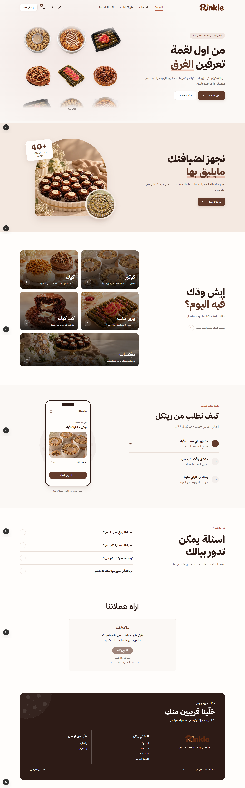
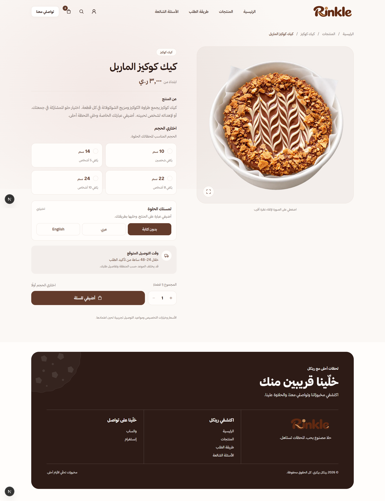
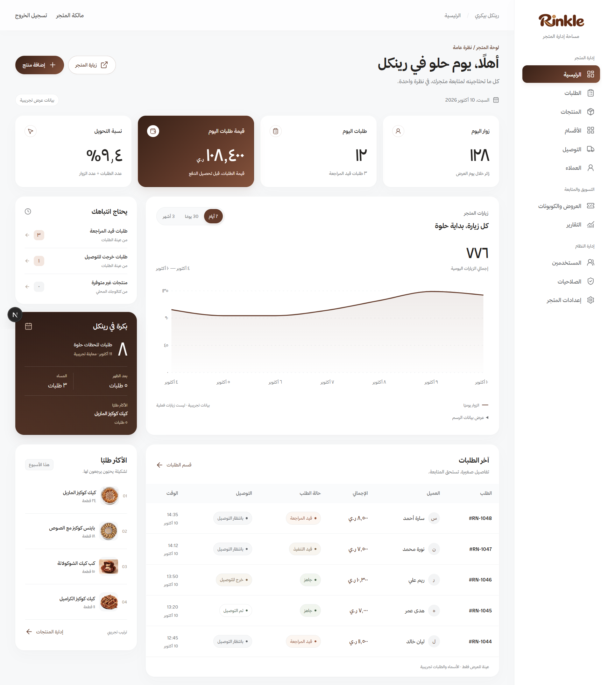
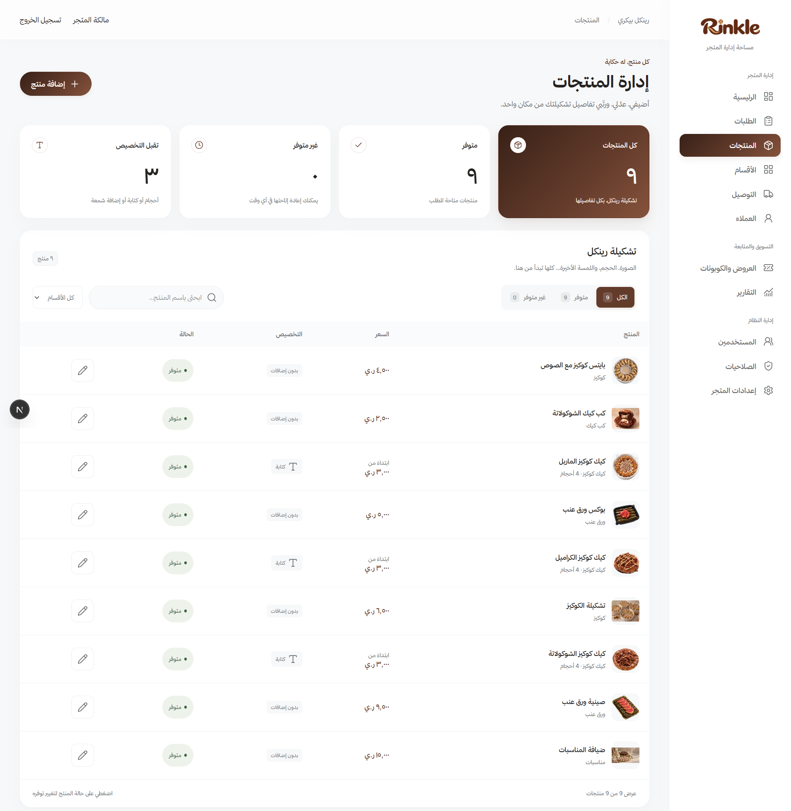

# Rinkle Bakery

**Arabic-first bakery e-commerce application | Next.js · TypeScript · PostgreSQL**

Rinkle Bakery is a responsive e-commerce web application for browsing and customizing bakery products, managing a shopping cart, and navigating a structured checkout experience. It also includes a multi-module administration dashboard for store operations.

The project emphasizes **software quality, input validation, authentication, access control, and automated checks**, alongside accessible, RTL-friendly interfaces.

## Screenshots

| Storefront                                                | Product details                                                            |
| --------------------------------------------------------- | -------------------------------------------------------------------------- |
|  |  |

| Admin dashboard                                    | Product management                                   |
| -------------------------------------------------- | ---------------------------------------------------- |
|  |  |

## Key Features

**Storefront**

- Responsive Arabic interface with right-to-left (RTL) support.
- Product browsing, search, category filters, and sorting.
- Product detail pages with supported size and message customization.
- Shopping cart with quantity management and persisted selections.
- Checkout, delivery details, and customer account interface flows.

**Administration**

- Dashboard views for metrics and operational summaries.
- Interfaces for products, categories, orders, customers, delivery areas, promotions, and reports.
- Data-entry forms with validation and clear loading, empty, and error states.
- Staff email/password authentication and session management with Better Auth.
- Server-side role-based access control (RBAC) for protected administrative actions.

## Testing & Quality Assurance

The project includes **32 automated tests** (reported in the October 25, 2026 project review), using the Node.js test runner and `tsx`. Test coverage includes:

- Role and permission rules, including access-control relationships.
- Authentication flows, session invalidation, identity separation, and request constraints.
- Input validation and rate-limiting logic.
- Promotion eligibility, discount calculations, and date boundaries.
- Reporting calculations and time-range filtering.
- CSV export formatting, including Arabic text and special-character handling.
- Database authentication schema and migration consistency checks.

**Quality checks:** ESLint, TypeScript validation, and application builds are run through GitHub Actions CI. The latest project report recorded passing automated tests and static checks.

> The automated suite focuses on application logic and security-related rules; it is not a claim of complete end-to-end or manual test coverage.

## Authentication & Security

- Better Auth for staff sign-in, logout, password changes, and session management.
- Separate customer and staff identity domains.
- PostgreSQL-backed authentication data and access-control records.
- RBAC permissions checked server-side rather than relying on hidden UI controls.
- Input, request-origin, and request-size validation in protected flows.
- PostgreSQL-backed login attempt limiting and a controlled owner-account bootstrap process.

Customer phone-number OTP integration is planned separately; it is not presented as an active production authentication flow.

## Tech Stack

| Area                    | Technologies                                   |
| ----------------------- | ---------------------------------------------- |
| Application             | Next.js 16, React 19, TypeScript               |
| Styling                 | Tailwind CSS 4, CSS, RTL support               |
| Forms & validation      | React Hook Form, Zod                           |
| Authentication          | Better Auth                                    |
| Database                | Neon PostgreSQL, Prisma 8 Contract, `pg`       |
| Client-side persistence | IndexedDB, localStorage, sessionStorage        |
| Visualization & UI      | Recharts, Lucide React, Motion                 |
| Testing & quality       | Node.js Test Runner, `tsx`, ESLint, TypeScript |
| CI/CD                   | GitHub Actions, Vercel                         |

## Project Structure

```text
src/
├── app/               # Storefront, admin pages, layouts, and API routes
├── components/        # Reusable UI and layout components
├── features/          # Storefront and administration modules
├── lib/auth/          # Authentication and authorization logic
├── config/            # Shared app configuration
└── prisma/            # Prisma contract and generated files

migrations/             # Database migrations
tests/                  # Automated tests
docs/                   # Technical documentation
public/                 # Images, icons, and fonts
```

## Implementation Notes

The storefront and administration interfaces are implemented across several modules. **Some administration data is currently persisted locally using IndexedDB**, while authentication, sessions, roles, and permissions use PostgreSQL. Full database integration for store operations, real customer OTP verification, and production payment processing remain separate integration work.

This repository demonstrates both user-facing application development and the supporting **validation, testing, CI, and access-control practices** used to improve reliability as the project evolves.
